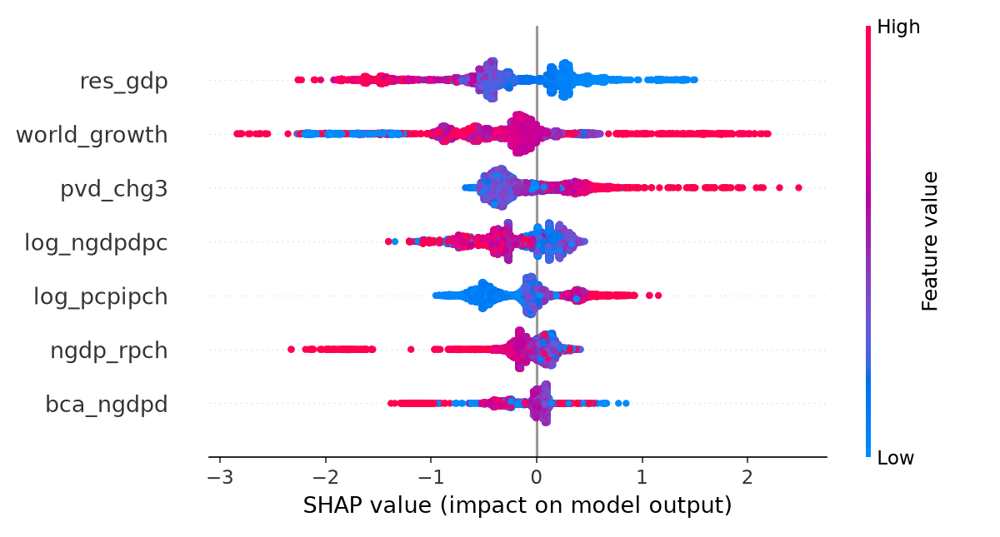
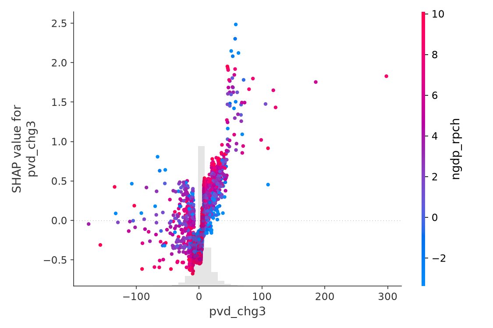

# Banking Crisis Early Warning: Logit vs. XGBoost

## Update: Results - November 2026

**Summary:** Using seven macro indicators, neither logit nor XGBoost predicted systemic banking crises one to two years ahead better than chance in an expanding-window backtest (2000 to 2023). XGBoost did learn an economically sensible credit boom threshold that logit missed, but this did not translate into better out-of-sample ranking. SHAP reveals that the model used world GDP growth to memorize specific years, and the indicators carried no information on the channels that drove most 2008 crises (bank foreign funding, asset prices, exposure to foreign assets).

### 1. Variables and Initial Expectations

| Variable | Transformation | What we expected                                                                                                    |
|---|---|---------------------------------------------------------------------------------------------------------------------|
| Real GDP growth | As reported | Weak growth hurts borrowers and bank asset quality                                                                  |
| Inflation | log(1 + inflation) | High inflation signals macro instability and erodes bank balance sheets. The log compresses hyperinflation episodes |
| Current account balance (% of GDP) | As reported | Large deficits mean reliance on foreign funding and exposure to a shock                                             |
| GDP per capita | Log | Control for level of development. Lower-income countries had more crises historically                               |
| Private debt (% of GDP) | 3-year change, percentage points | Rapid credit expansion is the most cited precursor of banking crises. This was the core variable                    |
| FX reserves excluding gold (% of GDP) | Ratio | A buffer against capital outflows and runs on foreign currency funding                                              |
| World real GDP growth | As reported | Global downturns hit many countries at once, as in 2008                                                             |

### 2. Results

Out-of-sample predictions cover 3,171 country-years (2000 to 2023) with 75 crisis precursors. 47 of the 75 are in 2006 and 2007, the two years before the 2008 to 2009 wave.

**Main metric (within-year AUC)** Countries are ranked against each other within the same year, which matches how an early warning model is used ("which countries look most vulnerable this year?"). Confidence intervals come from a block bootstrap that resamples test years (1,000 draws), because countries in the same year share the same global shock.

| Model | Within-year AUC | 95% CI | Excluding 2006-07 |
|---|---|---|---|
| Logit | 0.512 | 0.452 to 0.581 | 0.532 |
| XGBoost | 0.539 | 0.461 to 0.614 | 0.528 |
| XGBoost, trained with missing values kept (robustness) | 0.545 | not computed | 0.555 |
| Difference, XGBoost minus logit | +0.026 | -0.035 to +0.064 | |

Both confidence intervals include 0.5 and the difference between models includes zero. XGBoost slightly ranked better in 84% of bootstrap draws.

**Pooled AUC (All years ranked together).**

| Model | Pooled AUC | Excluding 2006-07 | PR AUC | PR AUC excluding 2006-07 |
|---|---|---|---|---|
| Logit | 0.364 | 0.525 | 0.031 | 0.049 |
| XGBoost | 0.332 | 0.533 | 0.017 | 0.012 |
| Random benchmark | 0.500 | 0.500 | 0.024 | 0.010 |

Pooled AUC is below 0.5 for both models which refers that they ranked crisis years below calm years. 

### 3. Evaluation and SHAP results




**World growth worked as a year identifier, not an economic signal.** Both models assigned their lowest average risk of any year to 2006 and 2007, when most crises were about to start. Models trained on 1980 to 2005 had learned that crises follow global slowdowns.

As the 2008 crises came at the end of a global boom, the final XGBoost model treated world growth as the second most important variable. However, SHAP showed it was isolating specific years: world growth in 2004 (5.27%) and 2006 (5.29%) differed by 0.02 percentage points, yet the model treated them in opposite ways because 2006 was followed by crises and 2004 was not. Having same values for all countries per year did not help rank countries within a year. Instead, it was used to memorize calendar time in a tree model.

**Credit booms matter, but only above a threshold.** The logit coefficient on the 3-year change in private debt was essentially zero. SHAP on the XGBoost model shows that the effect is flat or slightly negative for most observations until it grows by more than 5 to 10 percentage points of GDP. Booms above 30 points raised the odds of a crisis by roughly 3.5 times relative to no credit growth. A straight line fitted through mostly flat data comes out close to zero. The highest-risk booms were those where real growth had started to slow, though few observations support this pattern.




**The 2007 case shows which information was missing.** SHAP values for the model trained on 1980 to 2005, applied to 2007:

| Country | Credit growth | Reserves | World growth | Current account | Income level | Predicted risk rank | Crisis in 2008-09? |
|---|---|---|---|---|---|---|---|
| Iceland | +0.42 | -0.66 | -2.02 | -0.25 | +0.80 | 7 | Yes |
| Ireland | +0.41 | +0.03 | -1.83 | +0.17 | +0.43 | 8 | Yes |
| Germany | -0.16 | +0.33 | -1.26 | -2.68 | +0.31 | [rank] | Yes |
| Canada | -0.01 | +0.18 | -1.45 | +0.01 | +0.82 | 2 | No |
| Russia | +0.44 | -1.68 | -1.89 | -1.34 | -0.94 | [rank] | Yes |

(SHAP values in log-odds. Positive raises predicted risk. Ranks out of 135 countries.)

- Iceland's credit boom raised its risk, but the boom-year reading of world growth pushed it down by more. Iceland's reserves looked ample relative to GDP, but they were small relative to its banks' foreign currency liabilities, which reserves to GDP does not measure.
- Germany's large current account surplus lowered its predicted risk. Its banking problems came through holdings of U.S. assets, which were financed in part by that same surplus. No domestic macro indicator here captures this.
- Canada ranked second without a credit boom, mainly because the 1980 to 2005 model associated higher income with higher risk. Canada also holds few reserves because it has a floating exchange rate and deep FX markets, so low reserves to GDP does not mean what it means for an emerging market. The same applies to euro area members, whose reserves are pooled.
- Russia's large oil-era reserves made it look safe. Its 2008 to 2009 problems came from the collapse in commodity prices.

**Overall.** The seven indicators were designed around emerging market crises of the 1980s and 1990s (inflation, reserve shortfalls, current account deficits). The 2008 wave was mostly a financial cycle and cross-border exposure story. The XGBoost model learned the credit boom pattern only weakly before 2008 (SHAP of about +0.4 for Iceland and Ireland in 2007, against an average of +0.9 for large booms in the model trained through 2023), which suggests the data before 2008 did not contain enough examples of this type of crisis.

Note: SHAP describes what a fitted model learned from its training data. It does not show that a variable predicts future crises, and the backtest above shows that it largely did not.

### 4. Future Model Improvement: Variables and Method 

The changes below follow from the general failure patterns above rather than from searching for a higher AUC. Any of them should be specified in advance and evaluated once, with every attempt reported.

| Gap in the current indicators | What to add                                                                                                                                                                                                       | Why |
|---|-------------------------------------------------------------------------------------------------------------------------------------------------------------------------------------------------------------------|---|
| Credit is measured only as a 3-year change | Credit-to-GDP gap                                                                                                                                                                                                 | Measures a boom relative to a country's own trend, which separates financial deepening from excessive credit growth |
| No asset prices | Real house price growth, Equity price growth                                                                                                                                                                      | Many banking crises follow property or asset price booms that credit totals alone do not show |
| Reserves are measured against GDP | Short-term external debt to reserves, Bank foreign currency liabilities                                                                                                                                           | Vulnerability depends on how much foreign funding can run, not on the size of the economy |
| Only domestic conditions | Banks' cross-border claims                                                                                                                                                                                        | Banks can take losses abroad even when the domestic economy looks sound |
| No external price shocks | Terms of trade or Commodity prices weighted by export share                                                                                                                                                       | Commodity exporters can face banking stress when prices collapse |
| No information on bank health | Bank capital, nonperforming loans, loan-to-deposit ratio                                                                                                                                                          | Whether a boom ends in a crisis depends on how much loss the banking system can absorb |
| Reserves mean different things across exchange rate regimes | Separate treatment of currency union members (for example, ECB members) and advanced floating-rate economies                                                                                                      | These countries hold few reserves by design, so low reserves are not a sign of weakness |
| Global conditions enter as one value per year | Drop world growth from the tree model, or use global financial conditions (risk appetite, U.S. interest rates, global credit) only in interaction with country variables, or use country-specific external demand | A variable that is the same for every country cannot rank countries within a year and lets trees memorize years |

Method changes:

- Use real-time data vintages (past WEO editions) to reproduce what forecasters actually saw.
- Calibrate XGBoost probabilities. Class weighting inflated them, so only rankings are comparable here.
- Tune hyperparameters only with time-ordered nested validation.
- Broaden the target to include currency crises to increase the number of events.
- Consider quarterly data, since annual data blurs the timing of warning signals.

---

## Project description

### 1. Purpose and Question

Building a model to predict the start of a systemic banking crisis one to two years ahead using a set of standard macro-financial indicators. And, which of XGBoost and logit model will perform better?

The project was built to apply tree-based models to a country-year panel under a validation design that respects time order, and to interpret nonlinear model output with SHAP. The scope was kept deliberately small: seven indicators from public IMF data, no hyperparameter tuning, and one pre-specified design that was not changed after seeing the results.

### 2. Data sources and vintages

| Data | Source                                                                                              | Notes                                                                        |
|---|-----------------------------------------------------------------------------------------------------|------------------------------------------------------------------------------|
| Crisis dates (target) | Laeven and Valencia (2026), Systemic Banking Crises Database: 1970-2025, IMF Working Paper 2026/094 | 164 systemic banking crises in 120 countries                                 |
| Real GDP growth, inflation, current account, GDP in USD, GDP per capita, world growth, government debt | IMF World Economic Outlook, October 2026 vintage                                                    | Bulk CSV. Downloaded via IMF data                                            |
| Private debt | IMF Global Debt Database (IMF.FAD:GDD) - F3T4_PS_POGDP_PT                                           | Debt securities and loans, private sector, % of GDP. Downloaded via IMF data |
| FX reserves | IMF International Liquidity (IMF.STA:IL) - RXF11_REVS, USD                                  | Reserves excluding gold. Downloaded via IMF data                             |
| Real effective exchange rate | IMF Effective Exchange Rates (IMF.STA:EER), CPI-based                                       | Cleaned but not used in the main model (see Design decisions), Downloaded via IMF data              |

All data are the latest revised figures, not real-time vintages. Countries are matched by ISO3 codes using a mapping written in the code. The WEO forecast years (2026 to 2031) are kept in the panel but not used.

Issues found in the crisis file and how they were handled:

- The paper's text lists three borderline cases (Nicaragua 2018, Vietnam 2022, Sri Lanka 2023), but the file flags only Vietnam. Borderline cases follow the paper's text.
- Start years for Angola, Ghana, and Republic of Congo differ across the paper's tables. The Excel file is used.

### 3. Sample and Target

- **Unit:** country-year, 197 WEO countries, 1980 to 2025.
- **Target:** equals 1 in year t if a systemic banking crisis starts in t+1 or t+2.
- **Excluded:** crisis years to avoid post-crisis bias, and the window around the three borderline cases (two years before the start through the end of the crisis, or 2025 if no end is recorded).
- **Labeled sample:** 1980 to 2023, 8,143 country-years, 303 positives (3.7%). Labels for 2024 and 2025 are not yet known.
- **Complete-case sample used for the main comparison:** 4,877 country-years, 178 positives, 150 countries.

Countries with no crisis in the database are coded as never having a crisis. The eight WAEMU members have no national reserves data because reserves are pooled at the regional central bank, so they drop out of the complete-case sample.

### 4. Design Decisions

| Decision | Choice | Reason |
|---|---|---|
| Additional one-year lag on predictors | Not added | The target already looks one to two years ahead. A further lag would push the horizon to two to three years |
| Real effective exchange rate | Excluded from the main model | Available for 94 countries only, and missing for 54 of the 120 crisis countries. |
| Government debt | Excluded from the main model | 93% missing in the 1980s and 56% in the 1990s |
| Missing values | Complete case for both models, so they are compared on the same rows. XGBoost trained with missing values kept is reported as a robustness check, evaluated on the same test rows | Missingness in private debt is mostly in early years, so dropping rows costs early training data but leaves the 2000 to 2023 test period nearly intact (8 of 125 dropped positives are in the test period) |
| Logit | No penalty. Predictors winsorized at the 1st and 99th percentiles and standardized, using training-sample cutoffs and moments only | Comparable to a standard logit. Training-only statistics avoid look-ahead |
| XGBoost | 300 trees, maximum depth 2, learning rate 0.05, positive class weight equal to the negative-to-positive ratio in each training window, no tuning | Shallow trees allow two-way interactions without fitting noise in a small sample |
| Main evaluation metric | Within-year AUC, with pooled AUC reported as a diagnostic | Pooled AUC also rewards predicting which years are risky, and it mixes probabilities from models retrained each year on different scales |

### 5. Validation design

- **Expanding window backtest:** For each test year T from 2000 to 2023, both models are retrained on all years up to T-2 and used to predict year T.
- **Why T-2 instead of T-1:** The label for year T-1 depends on whether a crisis starts in year T+1, which is not known in year T. Training on it would leak future information.
- **Metrics:** Within-year AUC (main), pooled ROC AUC, Gini, and PR AUC, each for all test years and excluding test years 2006 and 2007 (the precursors of the 2008 to 2009 crises).
- **Uncertainty:** Block bootstrap over test years, 1,000 draws, seed 42. Resampling years rather than rows accounts for countries in the same year sharing the same global shock.
- **Interpretation:** SHAP (TreeExplainer) on an XGBoost model trained on the full complete-case sample (1980 to 2023), and on the 2007 model for a case study.

### 6. Repository structure and how to run

```
crisis-early-warning/
├── README.md
├── requirements.txt
├── data/
│   ├── raw/          # original downloads, not modified
│   └── processed/    # cleaned files, panel, predictions, shap result table
├── src/
│   ├── 01_clean_crises.py     # crisis dates → crises_clean.csv
│   ├── 02_clean_weo.py        # WEO → weo_clean.csv
│   ├── 03_clean_debt.py       # Global Debt Database → debt_clean.csv
│   ├── 04_clean_EER_data.py   # REER → reer_clean.csv (robustness only)
│   ├── 05_clean_reserves.py   # International Liquidity → reserves_clean.csv
│   ├── 06_build_panel.py      # merge, transform, target → panel.csv
│   ├── 07_models.py           # logit and XGBoost backtest → oos_predictions.csv, backtest_diag.csv
│   ├── 08_evaluation.py       # AUC, PR AUC, within-year AUC, bootstrap
│   └── 09_shap.py             # SHAP summary, dependence plot (folder "figures"), 2007 case table ("shap_2007_cases.csv")
└── figures/
    ├── shap_summary.png
    └── shap_dependence_pvd_chg3.png
```

### 7. Limitations

- **Revised data:** Predictors use the latest revised figures and ignore publication lags. Real-time performance would likely be lower.
- **Few events, dominated by GFC:** The test period has 75 positives, 47 of them before the 2008 to 2009 crises. Results excluding GFC are on 28 positives.
- **Complete case drops early crises:** 125 of 303 positives are dropped, mostly before 2000, including several Latin American crises of the 1980s.
- **Limited indicator set by design:** See "Future Model Improvement: Variables and Method" above.
- **Reserves to GDP is not comparable across regimes:** It understates the buffer of currency union members and advanced floating-rate economies.
- **Probabilities are not calibrated:** XGBoost class weighting inflates predicted probabilities. Only rankings are compared.
- **SHAP is in-sample:** It explains what a fitted model learned, not what predicts future crises.
- **Crisis dating:** Borderline cases follow the paper's text, and start years follow the Excel file where the paper's tables disagree.

### 8. References

- Laeven, L. and F. Valencia (2026). "Systemic Banking Crises Database: 1970-2025." IMF Working Paper 2026/094.